# idanime

Anime themes for IDA Pro 9.x. Twelve colour schemes, each with its own
background art in the bottom-right corner of the disassembly, pseudocode and
graph views.

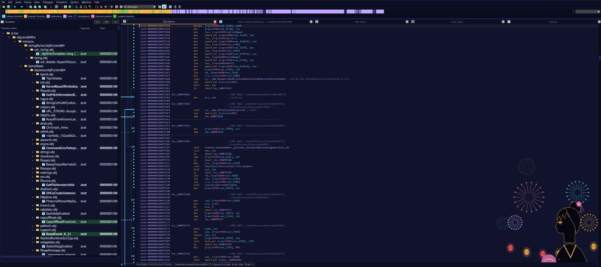

The art also shows in graph view (with the included plugin):

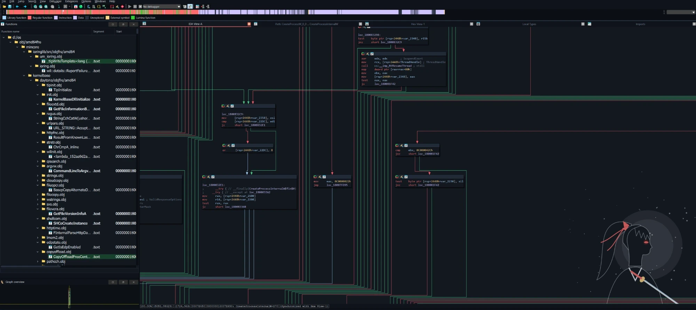

## Themes

| | |
|---|---|
| **sakura-yoru**: cherry blossoms, purple night 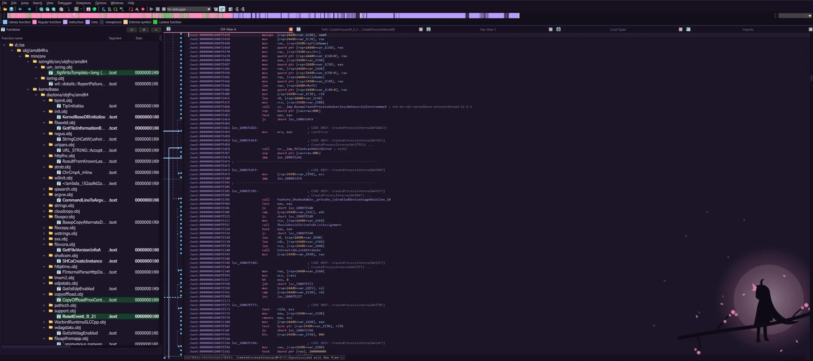 | **neon-ronin**: synthwave sun, city skyline 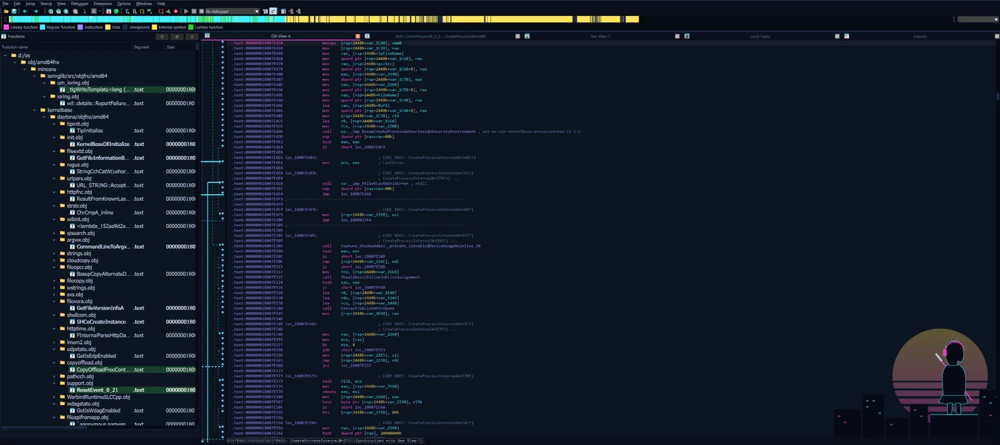 |
| **hoshizora-witch**: witch on a crescent moon 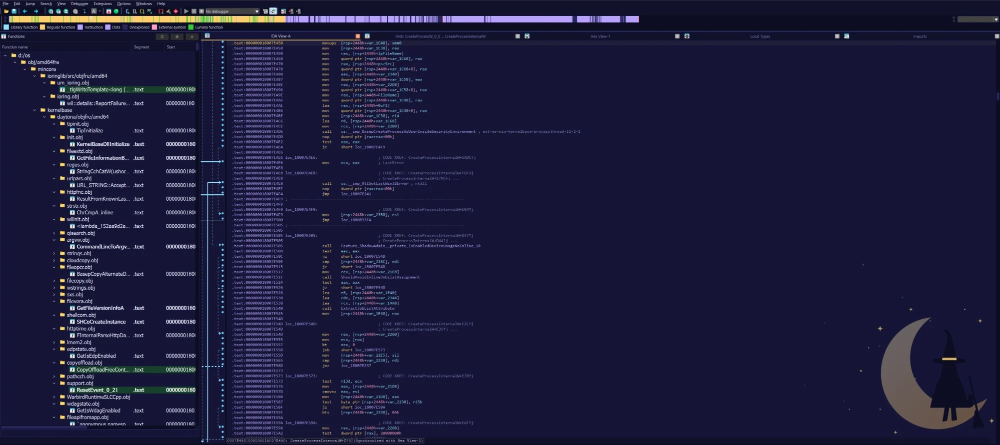 | **kitsune-yuki**: fox girl, snow, icy blue 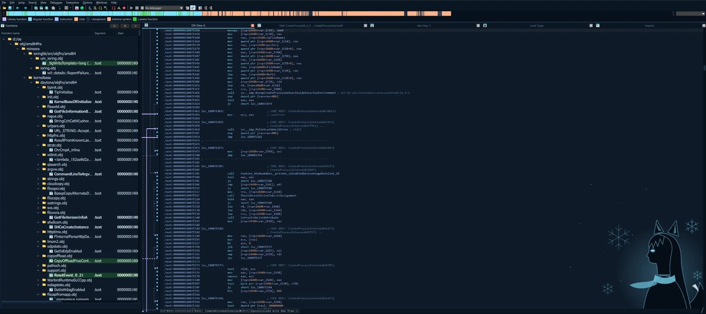 |
| **akatsuki-torii**: torii gate, kitsune mask, red dawn 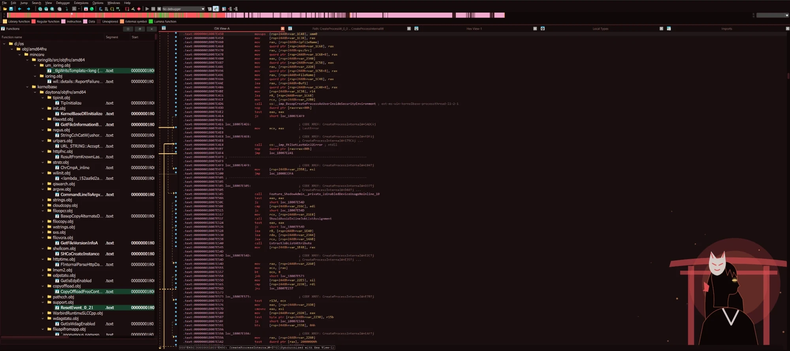 | **ame-lofi**: rainy window, headphones 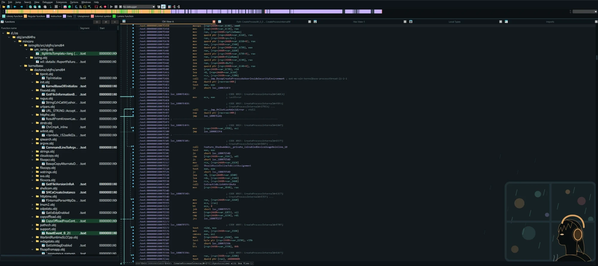 |
| **kurenai-vampire**: crimson moon, bats 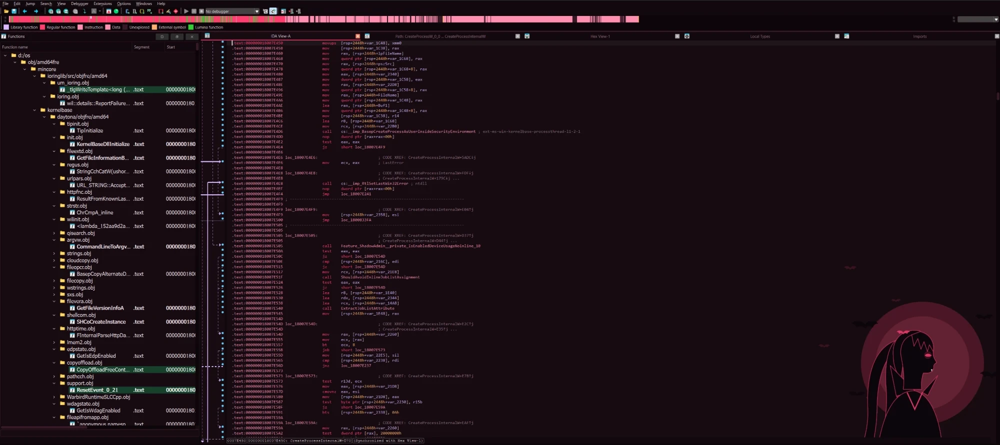 | **kido-pilot**: mecha pilot HUD 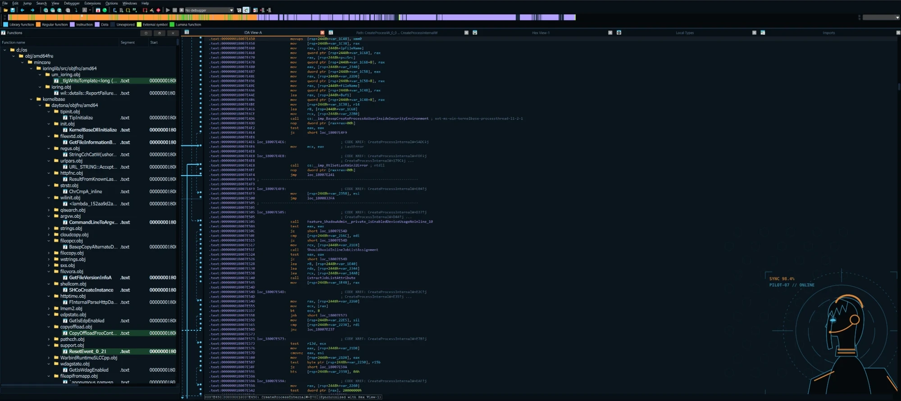 |
| **denno-hacker**: green katakana rain 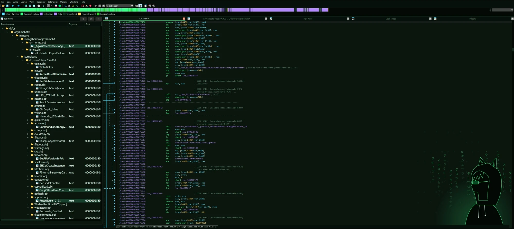 | **yuki-samurai**: samurai, grey moon 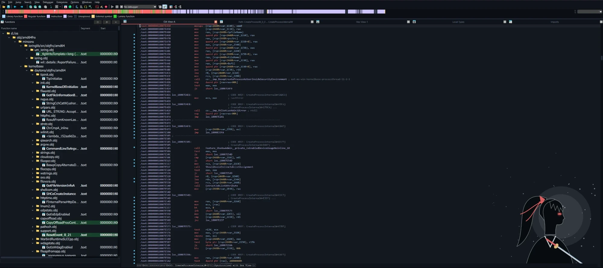 |
| **maho-pastel** (light): magical girl, pink pastel 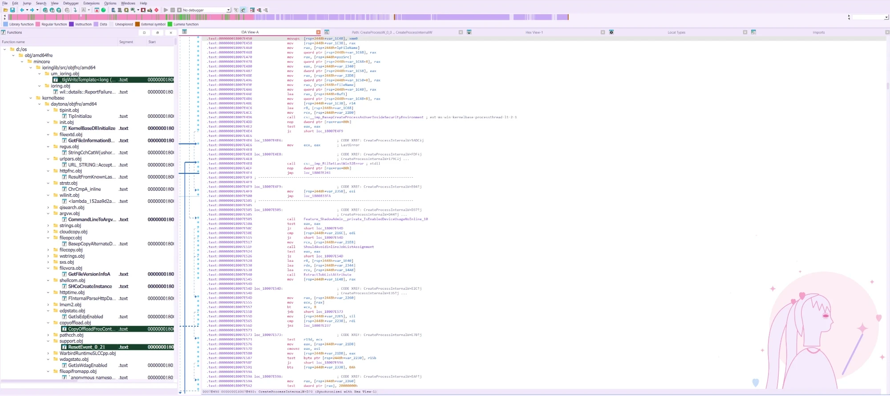 | **natsu-matsuri**: summer festival fireworks  |

All the artwork side by side:

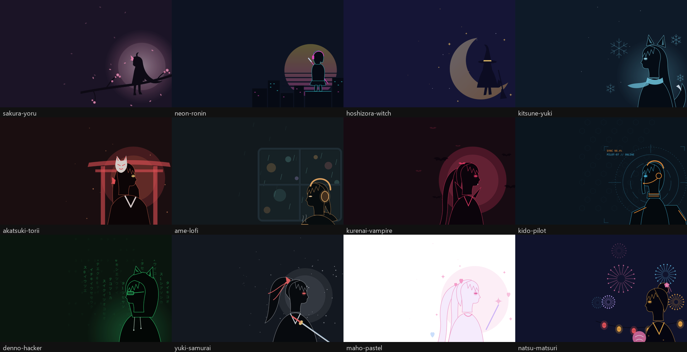

## Install

You need IDA Pro 9.x (tested on 9.5). The plugin needs IDAPython, which IDA 9
ships with.

### 1. Get the files

```
git clone https://github.com/shwetsoni/idanime.git
```

or download the ZIP from GitHub and extract it.

### 2. Copy the themes

Copy every folder inside `themes/` into IDA's user themes directory. Create the
`themes` folder if it doesn't exist yet.

| OS | User themes directory |
|---|---|
| Windows | `%APPDATA%\Hex-Rays\IDA Pro\themes\` |
| Linux / macOS | `~/.idapro/themes/` |

Windows (PowerShell, run from the `idanime` folder):

```powershell
New-Item -ItemType Directory -Force "$env:APPDATA\Hex-Rays\IDA Pro\themes" | Out-Null
Copy-Item -Recurse -Force .\themes\* "$env:APPDATA\Hex-Rays\IDA Pro\themes\"
```

Linux / macOS:

```sh
mkdir -p ~/.idapro/themes
cp -r themes/* ~/.idapro/themes/
```

You should end up with e.g. `...\themes\natsu-matsuri\theme.css`, `art.png`
and `art@2x.png`.

### 3. Copy the graph-view plugin

Copy `plugins/anime_graph_bg.py` into IDA's user plugins directory.

| OS | User plugins directory |
|---|---|
| Windows | `%APPDATA%\Hex-Rays\IDA Pro\plugins\` |
| Linux / macOS | `~/.idapro/plugins/` |

Windows (PowerShell):

```powershell
New-Item -ItemType Directory -Force "$env:APPDATA\Hex-Rays\IDA Pro\plugins" | Out-Null
Copy-Item -Force .\plugins\anime_graph_bg.py "$env:APPDATA\Hex-Rays\IDA Pro\plugins\"
```

Linux / macOS:

```sh
mkdir -p ~/.idapro/plugins
cp plugins/anime_graph_bg.py ~/.idapro/plugins/
```

The themes work without the plugin, but then the art only shows in text views.

### 4. Pick a theme

1. Restart IDA.
2. Go to **Options > Colors...**
3. Choose one of the themes (e.g. `natsu-matsuri`) in the **Theme** dropdown
   and click **OK**.

Open any database. The art sits in the bottom-right of the disassembly view.
Press **Space** to switch to graph view; the art should stay there, shown once.

### Updating / uninstalling

To update, copy the new files over the old ones and restart IDA. To uninstall,
switch back to a built-in theme, then delete the theme folders and
`anime_graph_bg.py`.

## How it works

**Text views** use plain theme CSS. `CustomIDAMemo` gets transparent line
backgrounds and a fixed `background` image anchored bottom-right (the same
trick Hex-Rays described in their blog post on styling listing backgrounds).

**Graph view** can't do that: IDA paints the graph canvas itself and ignores
the alpha of the graph background colours. So `anime_graph_bg.py` adds a
click-through overlay on top of the graph canvas and blends the art in:

- `Lighten` blending on dark themes and `Darken` on the light one, so code and
  nodes stay readable on top of the art
- draws only while the view is actually in graph mode (the text listing and
  the graph share the same Qt viewport, so it asks IDA for the current
  renderer), so the art never shows twice
- uses `art@2x.png` on scaled displays and pre-scales it once, so a repaint is
  just a blit
- no timers or polling. It finds views at startup and when focus moves, and
  notices theme switches through Qt's style-change event.
- picks the active theme from IDA's stylesheet automatically and does nothing
  for themes without an `art.png`. Any error means it simply draws nothing.

## Resource usage

The themes themselves are plain CSS and cost nothing extra. The plugin is the
only part that does any work. Measured on IDA Pro 9.5, Windows 11, 125% display
scaling, idle in graph view, plugin on vs off (4 runs of 60 s each):

| | Plugin off | Plugin on | Difference |
|---|---|---|---|
| CPU, idle in graph view | 3.6% of one core | 5.0% of one core | about +1.3% |
| Memory (IDA private bytes) | ~327 MB | ~335 MB | about +8 MB |
| Cached art image | – | 3.4 MB | one image, sized for your display |
| Full graph repaint | 12–13 ms | 13–14 ms | about +1 ms |
| Text view | – | – | no cost (the plugin doesn't draw there) |

Most of the idle CPU comes from IDA repainting the graph twice a second on its
own; the overlay has to be redrawn with it. There are no timers or background
threads in the plugin.

## Customising

- **Change the art**: replace `art.png` (960x600) and `art@2x.png` (1920x1200)
  in a theme folder with any transparent PNG. Keep the character in the
  bottom-right.
- **Turn the text-view art off**: delete the `background*` lines in the first
  `CustomIDAMemo` block of `theme.css`.
- **Plugin settings** (top of `anime_graph_bg.py`):
  - `ART_OPACITY` controls how strong the art is in graph view (default `0.9`)
  - `THEME_OVERRIDE` forces a theme folder name if auto-detection fails
  - `DEBUG = True` logs to the Output window

## Troubleshooting

- **Theme doesn't show up in the dropdown.** Make sure the folder sits directly
  in `themes\` (`themes\natsu-matsuri\theme.css`), not one level deeper.
- **Art drawn twice in text view.** An older copy of a theme is probably still
  being loaded. IDA reads `theme.css` from both the install `themes\` folder and
  your user `themes\` folder. Keep only one copy of each theme.
- **No art in graph view.** Check that `anime_graph_bg.py` is in the user
  `plugins` folder and that you restarted IDA. If the theme isn't detected, set
  `THEME_OVERRIDE`.

## License

[MIT](LICENSE)
